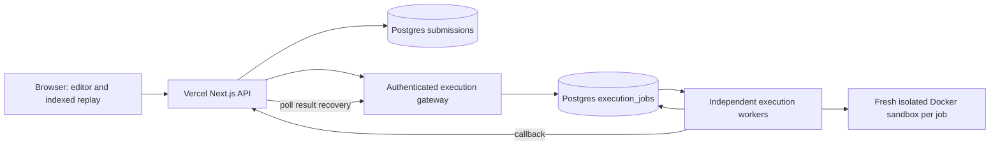

# CodeAutopsy architecture and scaling

## Implemented execution path

The current deployment uses Vercel Functions → private PostgreSQL admission/ownership/launch records → one credential-free Vercel Sandbox VM per submission → bounded result retrieval → PostgreSQL terminal persistence → VM deletion. Each program stage has its own non-root namespace and read-only toolchain. See [native execution](VERCEL-NATIVE-EXECUTION.md) for budgets, recovery, retention and snapshot refresh.

## Alternative HTTP worker path

Vercel hosts the Next.js UI and API. The API validates a bounded request, persists a submission, then sends an authenticated job to an execution service. Original source determines compiler/runtime/output verdicts. A separate instrumented run produces bounded evidence. The API persists completed results through callback or polling recovery. Browser diagrams use captured values, never generated illustrations.

Production workers require the shared Postgres queue. Local development retains a bounded memory queue and a local filesystem store. Memory-queue jobs are lost on restart; this mode is never advertised as production-ready.

## Queue correctness

Admission uses a short transaction and a shared advisory lock to enforce global queue capacity. Job IDs are idempotent only when their SHA-256 payload fingerprints match. Workers claim with `FOR UPDATE SKIP LOCKED`, then execute outside the transaction. Claims receive a unique token, a 60-second lease and a bounded attempt count. Heartbeats renew leases every 15 seconds. Expired claims are recoverable by another worker. Terminal writes must match an unexpired token, fencing stale workers. Execution is at least once; a lease outage can duplicate computation. This system does not claim exactly-once execution.

Each worker limits local concurrency independently. The configured queue capacity is shared across replicas. Completed worker results expire after one hour; durable submission results remain separately persisted. Retention of submission source/results must be configured to the product's data policy before public scale. The worker must use a database role restricted to queue tables; sandbox processes receive no database/auth/provider credentials.

## Isolation boundary

Production execution requires Docker mode on a dedicated execution host. Job containers run without networking, as a non-root user, with read-only runtime files, capped output, wall-clock timeout, resource limits and a separate trace mount. Local subprocess mode is a trusted development mode and does not enforce a security boundary or an OS memory quota. The Docker daemon is privileged infrastructure: isolate the host, protect its socket and run no unrelated sensitive workloads there. Container hardening is not a substitute for a multi-tenant VM boundary at large public scale.

## Visual engine

The index stores persistent call-frame pointers and per-variable ordered histories. It uses O(events) storage instead of copying full variable maps into checkpoints. A seek materializes only the visible frame/global values using binary search; it never scans the whole event stream. Recorded call frames preserve recursive local values on return. Caller locals are not presented as the current function's locals. Histories are explicitly by variable name across captured calls. Scope fidelity still depends on instrumentation: asynchronous calls, closures, exceptions and unsupported constructs require richer frame/task IDs before claiming complete language semantics.

The timeline renders at most 160 overview groups; its slider seeks exact events. Search results paginate 30 rows. Variables are searchable with at most 201 selector options and a 200-row comparison table. Array/string views paginate 24 cells; matrices paginate 24 rows and show at most 24 columns with serialized data available. Structure diagrams limit 60 captured nodes and 150 edges. These bounds avoid DOM growth proportional to the full trace.

Tree/linked candidates require valid captured JSON with `left/right`, `children` or `next` fields. Adjacency candidates require explicit neighbor IDs that exist as captured keys. Interpretation is opt-in, with provenance explained. Cyclic/depth-limit markers remain partial placeholders: object identity and missing edges are not invented. Matrix views do not pretend every table is dynamic programming. Algorithm-specific semantics must come from an explicit mapping contract or a verified adapter, not names like `dp`, `visited` or `root` alone.

## Scaling stages

1. Configure Postgres migrations, an authenticated isolated execution host, TLS, database backups, firewall admission rules and abuse controls. Start with one worker and measured concurrency.
2. Add workers sharing the durable queue. Track queue age, claim/renew failures, compiler/runtime duration, timeout rate, result size and API error rate. Load-test shared capacity and database pool limits before raising concurrency.
3. Move large immutable traces to object storage with versioned manifests and chunked event retrieval. Keep submission status, ownership and trace references in Postgres. Today's capped JSON result endpoint is intentionally a bounded initial implementation, not an unlimited trace-storage architecture.
4. Introduce user/session ownership, per-user quotas, fair scheduling and tenant VM isolation before unrestricted public execution. Add worker admission/lease dashboards and dead-letter inspection. Autoscale from queue age and resource saturation, not request count alone.
5. Rich object identity, task/frame IDs and typed structure adapters should be versioned in the shared schema and validated against independent original runs. Add adapter acceptance fixtures for graph traversal, tree rotations, linked-list rewrites, DP updates and backtracking before claiming automatic semantic animation for arbitrary implementations.

## Evidence and remaining boundaries

Local Postgres integration tests exercise shared capacity, concurrent claims, lease recovery and stale-write fencing. They do not establish production load, failover or latency SLOs. Local execution tests cover all five language toolchains and selected instrumentation semantics. Docker containment tests passed on the Linux CI host; this Windows host does not provide Docker. No claim is made of universal bug detection, perfect arbitrary-code animation or proven usability for every age. Learn mode uses plain English, slower replay and consistent explanations; classroom usability should be assessed with actual learners.

Research foundations: [PostgreSQL locking](https://www.postgresql.org/docs/current/sql-select.html), [OpenTelemetry observability](https://opentelemetry.io/docs/concepts/observability-primer/), [Python Tutor execution views](https://pythontutor.com/visualize.html), [VisuAlgo structures](https://visualgo.net/en).
